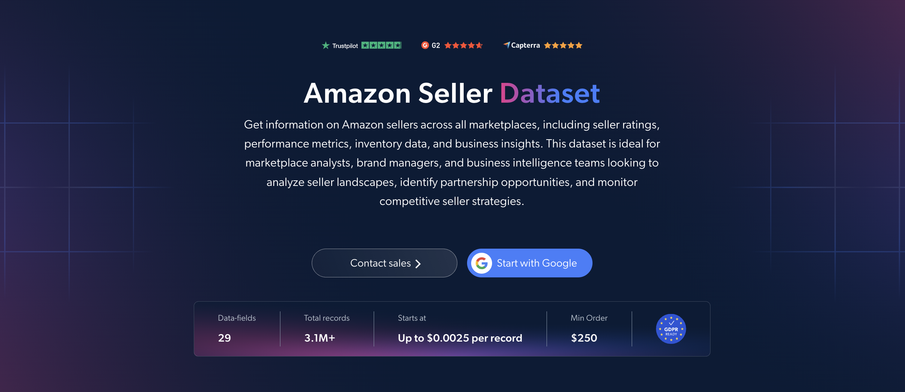

# Amazon 卖家数据集样本

<h2>包含 1000 个亚马逊卖家的示例数据集</h2>

<a href="https://www.bright.cn/products/datasets/amazon/sellers">
   
</a>

包含 1000 个卖家资料的亚马逊卖家数据集样本。该数据集使用 <b>Bright Data API</b> 提取。

<h2>数据集中包含的部分数据点：</h2>

* ```seller_id```：每个卖家的唯一标识符
* ```url```：卖家亚马逊页面的 URL
* ```seller_name```：亚马逊卖家名称
* ```buisness_name```：卖家的官方企业名称
* ```country```：卖家所在国家/地区
* ```description```：卖家概况
* ```stars```：根据反馈得出的平均星级评分
* ```feedbacks```：收到的反馈总数
* ```rating_positive```：好评率
* ```feedbacks_percentages```：好评、中评和差评明细
* ```rating_count_m1```：过去 1 个月的评分数量
* ```rating_count_m3```：过去 3 个月的评分数量
* ```rating_count_m12```：过去 12 个月的评分数量
* ```rating_count_lifetime```：历史评分总数
* ```products_count```：卖家提供的商品总数
* ```products_link```：卖家商品链接
* ```brands```：卖家销售的品牌
* ```return_policy```：卖家的退货政策
* ```shipping_policies```：卖家的配送政策
* ```delivery_rates```：卖家的配送费率

以及更多内容。

这是“亚马逊卖家信息（公开数据）”数据集的示例子集，该完整数据集包含超过 <b>3,100,000 个卖家</b>。

可用的数据集文件格式：<b>JSON、NDJSON、JSON Lines、CSV、XLSX 或 Parquet。还可选择将文件压缩为 .gz 格式</b>。

数据集交付方式选项：<b>电子邮件、API 下载、Webhook、Amazon S3、Google Cloud Storage、Google Cloud Pub/Sub、Microsoft Azure、Snowflake、SFTP</b>。

更新频率：<b>单次、每日、每周、每月、每季度、每半年或自定义频率</b>。

可在已提取的数据点基础上添加数据增强：<b>根据需求提供。</b>

<b>[获取完整的亚马逊卖家数据集](https://www.bright.cn/products/datasets/amazon/sellers)</b>。

<a href="https://www.bright.cn/products/datasets/amazon/sellers">
</a>

<h2>亚马逊卖家数据集有哪些用例？</h2>

<h3>1. 合作机会</h3>
品牌和电商平台使用亚马逊卖家数据集，发掘业绩优异且拥有良好过往记录的卖家。通过分析星级评分、反馈数量和商品范围，可以确定可靠的分销、品牌合作或电商平台扩张伙伴。

<h3>2. 竞争对手监控</h3>
企业持续跟踪竞争对手卖家经营的品牌、商品数量和客户反馈。通过比较过去 1 个月、3 个月和 12 个月的评分数量，可以了解哪些卖家正在增长、哪些卖家正在失去增长势头，以及其市场定位如何变化。

<h3>3. 卖家绩效分析</h3>
分析师会比较不同国家/地区和品类中卖家的评分、好评率和历史评分总数。这有助于评估卖家的可靠性、识别市场趋势，并发掘亚马逊电商平台上的增长机会。

<h2>面向学术研究人员和 NGO 免费开放网页爬虫工具及数据集</h2>

Bright Initiative 为顶尖院系和学术研究人员，以及致力于推动各类环境与社会公益事业的 NGO 和 NPO，提供 Bright Data 的 <b>[网页爬虫工具 API](https://www.bright.cn/products/web-scraper)</b> 和 <b>[即用型数据集](https://www.bright.cn/products/datasets)</b>。你可以在<b>[此处](https://brightinitiative.com)</b>提交申请。
